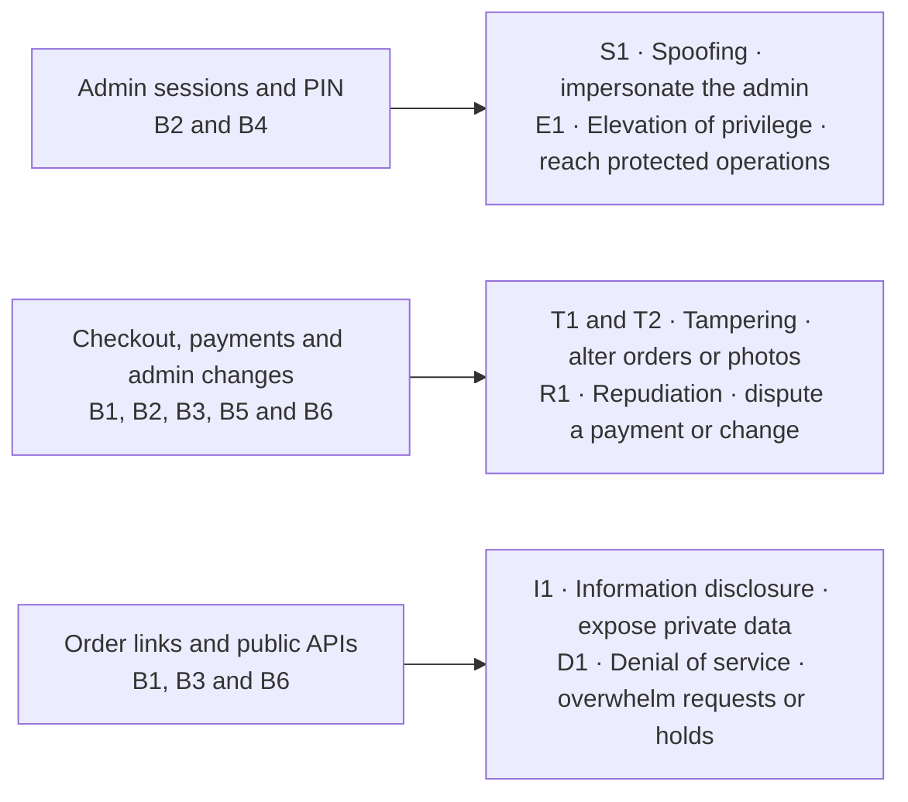

# Vault & Vein STRIDE diagram

This model maps threats to the boundaries and numbered flows in the [trust boundary diagram](trust-boundaries.md). It covers the implemented storefront, store admin and hosted integrations shown there. Controls below are visible in the repository. Follow-up checks identify work that would increase confidence in a deployment.

## Threat register

| ID | Threat and flow | Controls in the repository | Follow-up check or mitigation |
| --- | --- | --- | --- |
| **S1 · Spoofing** | A party impersonates the approved admin or reuses stale sign-in proof. B2 and B4, F3–F4. | The OAuth callback checks an attempt cookie and exchanges a Neon verifier. Protected requests require the approved verified email, a current Neon session and a signed PIN proof. PIN reset uses email OTP and changes the PIN revision. | Confirm the deployed Neon trusted origins and Google OAuth setup. Verify mailbox recovery and session revocation after a PIN change. |
| **T1 · Tampering** | Untrusted checkout values or a false provider notification could change price, stock or payment state. B1, B3 and B6, F2, F5 and F8–F9. | Postgres calculates the amount from current prices, locks product rows and records unique holds. The PayHere handler validates the merchant, LKR currency, allowed status, format and signature. The database checks the stored total and deduplicates provider events. | Run the hosted sandbox check for success, cancellation, duplicate notifications and late confirmation before enabling live checkout. |
| **T2 · Tampering** | Unvalidated images or conflicting gallery changes could alter a published product. B2 and B5, F3 and F6. | Admin actions validate file type, content signature, upload size and capacity. The Cloudinary adapter checks the returned delivery path. Gallery writes use a revision check to prevent an older editor from overwriting newer changes. | Confirm the Cloudinary credentials belong to the intended environment. Verify upload rejection and concurrent gallery editing during release testing. |
| **R1 · Repudiation** | The store may need to establish who changed inventory, marked an order shipped or handled a payment. B2, B3 and B6, F3, F5 and F9. | Orders track payment and dispatch times. Payment events store provider identifiers, event status and receipt times. | Add an append-only audit record for consequential admin actions. Capture actor, action, target and time while minimizing personal data. The current schema has no dedicated admin audit table. |
| **I1 · Information disclosure** | Order links, delivery details, inbox messages or secrets could reach unintended parties. B1, B3 and B6, F1–F2, F5 and F8. | Order status requires an order ID and a matching access key. The page returns a limited status view and sends no-store and no-referrer headers. Admin routes gate access to the inbox and private order details. Credentials are read on the server. | Review application and platform logs for query-string and personal-data redaction. Define retention for order and inbox data. Treat order status URLs as bearer links, including the copies sent to PayHere as return and cancel URLs. |
| **D1 · Denial of service** | Repeated messages, sign-in attempts or abandoned reservations could reduce service and stock availability. B1 and B3, F1–F3 and F5. | Request handlers bound body size. Database-backed quotas protect checkout, messaging and PIN or OTP actions. Checkout holds expire after 20 minutes and the server releases them during checkout or admin flows. | Monitor rate-limit responses, repeated abandoned holds and Neon connection saturation. Assess host-level limits for sustained traffic. |
| **E1 · Elevation of privilege** | A public visitor, an unapproved Google user or an overly privileged database role could reach protected operations. B2 and B3, F3 and F5. | Privileged pages and Server Actions use the server-side admin guard. The PIN proof is bound to the session and current revision. Migrations enable row-level security and restrict public execution of sensitive functions. | Verify the live application role has only the privileges it needs and uses separate credentials from the migration role. Recheck unauthenticated and locked sessions after adding any admin action. |

## Verification references

- [Backend tests](../../tests/backend.test.mjs) cover restricted database roles, quotas, authoritative prices, concurrent stock holds and verified payment transitions.
- [Configured Chromium tests](../../tests/configured.spec.ts) cover unapproved sign-in, PIN setup and reset, browser Back after locking, inventory changes, image previews and the checkout flow against local provider fixtures.
- [Deployment and sandbox setup](../../README.md) describes the hosted checks for Google, Neon and PayHere.

STRIDE stands for Spoofing, Tampering, Repudiation, Information Disclosure, Denial of Service and Elevation of Privilege. [Microsoft STRIDE reference](https://learn.microsoft.com/en-us/azure/security/develop/threat-modeling-tool-threats)

The runtime login inherits `vault_store_runtime`. The separate migration owner owns the tables and constrained checkout functions. Order dispatch permits the paid-to-shipped transition. Server-side unlock records bind PIN proofs to a session and are revoked on lock or sign-out. Payment processing serializes receipts by order and signed status. Provider payment IDs are metadata.
