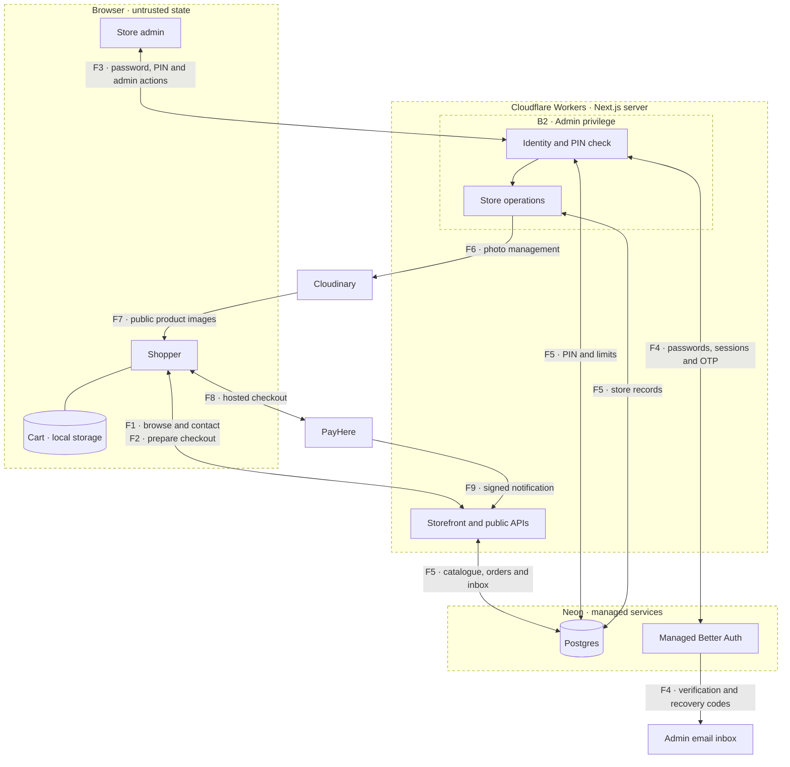

# Vault & Vein trust boundary diagram

The diagram models the application in its configured Cloudflare Workers deployment. It shows which component controls each operation and where data crosses between the browser, the app, Neon and the other hosted services. The dashed boxes outline trust zones. B2 is a privilege boundary within the Next.js application.

## Boundary register

| Boundary | Flows | Data and trust decisions |
| --- | --- | --- |
| **B1 · Browser ↔ application** | F1–F3 | The browser carries cart display data, shopper contact or delivery details, order access keys and admin session cookies. The server validates submitted data and reads current catalogue prices. Order lookups require both the order ID and access key. |
| **B2 · Authenticated identity ↔ admin privilege** | F3–F5 | A valid Neon session, verified allowlisted email and server-issued proof of password sign-in establish identity. A separate signed PIN proof bound to that session and the current PIN revision gates privileged reads and writes. The storefront navigation action clears the PIN unlock. |
| **B3 · Next.js ↔ Neon Postgres** | F5 | Server-only database credentials are used by Prisma. SQL functions enforce stock holds and apply payment events. Migrations enable row-level security on store tables and restrict public execution of sensitive functions. The live runtime role and grants depend on deployment configuration. |
| **B4 · Next.js and admin browser ↔ identity services** | F4 | Managed Better Auth validates the password, changes or resets it, and sends email codes. The app checks each privileged request against the live Neon session and verifies PIN setup and reset codes through Neon. |
| **B5 · Application and browsers ↔ Cloudinary** | F6–F7 | The server sends validated image uploads using server-only Cloudinary credentials and stores approved image references. Browsers fetch public product photos from the CDN. |
| **B6 · Browser and application ↔ PayHere** | F2, F8–F9 | The shopper submits a signed LKR form with order and delivery details and enters card details at PayHere. The return or cancel flow shows status. A verified server notification authorizes a payment state transition. |

### Code references

- [Admin identity and session proofs](../../src/lib/admin-auth.ts) · [PIN storage](../../src/lib/admin-pin.ts) · [Request security headers](../../src/proxy.ts)
- [Checkout route](../../src/app/api/checkout/route.ts) · [Payment form and order status lookup](../../src/lib/checkout.ts) · [PayHere notification route](../../src/app/api/payhere/notify/route.ts)
- [Database schema](../../prisma/schema.prisma) · [Database policies and functions](../../prisma/migrations/20261123000100_initial/migration.sql) · [Cloudinary uploads](../../src/lib/cloudinary.ts)

See the [STRIDE diagram](stride.md) for the threats and checks associated with these boundaries. The diagram describes repository behavior. Hosted provider settings and permissions require deployment-side verification. [Microsoft data-flow modeling reference](https://learn.microsoft.com/en-us/azure/security/develop/threat-modeling-tool-feature-overview)

The runtime login inherits `vault_store_runtime`. The separate migration owner owns the tables and constrained checkout functions. Order dispatch permits the paid-to-shipped transition. Server-side unlock records bind PIN proofs to a session and are revoked on lock or sign-out. Payment processing serializes receipts by order and signed status. Provider payment IDs are metadata.
